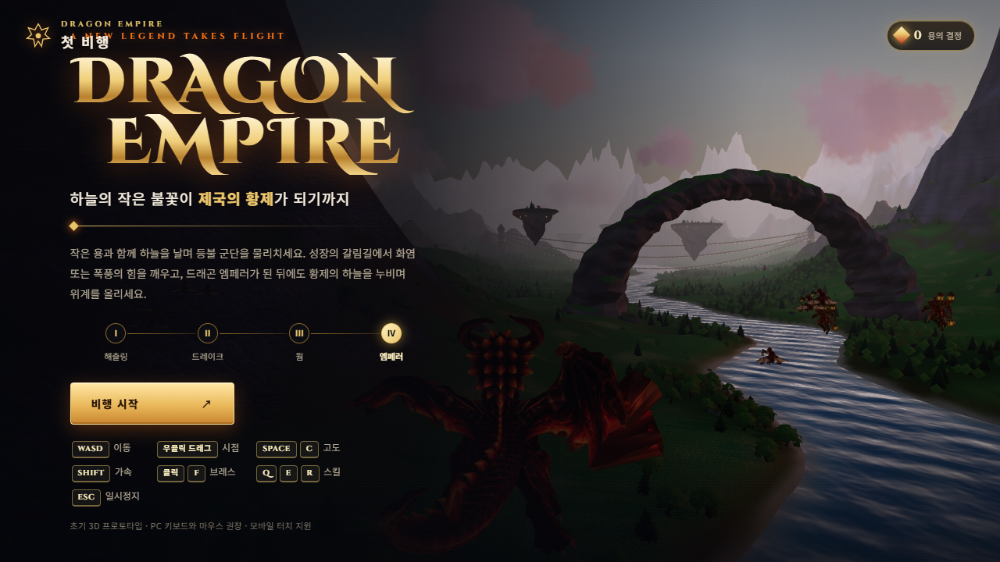
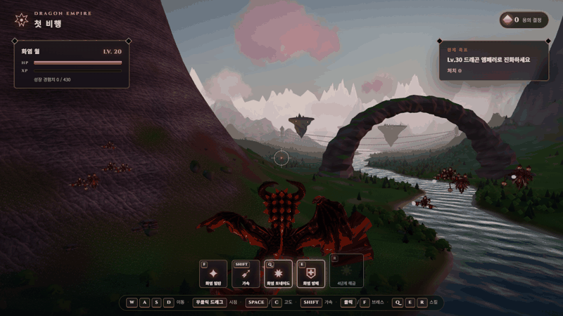
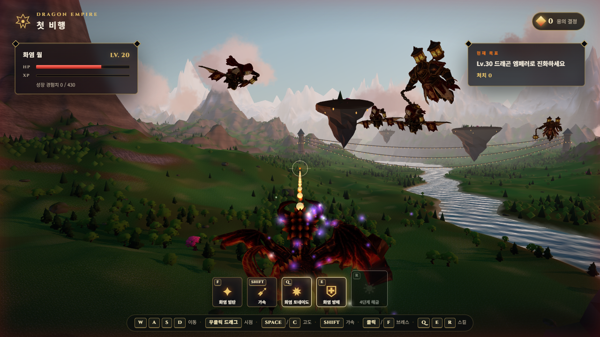

# Dragon Empire · 드래곤 엠파이어

**작은 용이 되어 하늘을 탐험하고 전투하며 드래곤 엠페러로 성장하는 3D 게임 프로토타입입니다.** 플레이어는 용 자신입니다. 현재는 웹 브라우저에서 공중 비행과 성장·전투를 시험할 수 있으며, 지상 탐험과 인간형 폴리모프는 개발 중입니다.



## 플레이 화면



*실제 게임 화면을 촬영한 GIF입니다. 화면 확인을 위해 Lv.20 화염 경로의 개발용 설정과 자동 키 입력을 사용했습니다. 화면의 연출과 밸런스는 개발 중 변경될 수 있습니다.*



## 풍향탑의 세 밤 (출시 준비 중인 모드)

낮에는 인간형 폴리모프로 재료를 모아 작업대에서 **탑 수리** 또는 **예보 방향 방어막** 중 하나를 고르고, 밤에는 용으로 이륙해 풍향탑으로 날아드는 등불 군단을 요격합니다. 밤을 넘길 때마다 진화하고, 셋째 밤에는 드래곤 엠페러로 대관한 뒤 탑을 노리는 루세르나와 싸웁니다.

- 실행: `node server.cjs` 후 **http://127.0.0.1:4178/?mode=nights** (같은 판 재현: `&seed=1234`)
- 출시 빌드: `node scripts/build-itch.mjs` → `dist/itch/`와 ZIP (업로드는 하지 않음, 쿼리 없이 세 밤으로 시작)
- 테스트: `node --test tests/*.test.mjs` (단위), Playwright 계측 `tests/nights-play.cjs`·`tests/nights-onboarding.cjs`·`tests/release-build.cjs`
- 설계 문서: [PIVOT_THREE_NIGHTS](docs/PIVOT_THREE_NIGHTS.md) · [WAVES](docs/NIGHTS_WAVES.md) · [BOSS](docs/NIGHTS_BOSS.md) · [ONBOARDING](docs/NIGHTS_ONBOARDING.md) · [RELEASE_ITCH](docs/RELEASE_ITCH.md) · [PLAYTEST_KIT](docs/PLAYTEST_KIT.md)
- 상태: 자동·계측 테스트만 통과. 사람 손 플레이 밸런스, 모바일 실기기, 실제 itch 임베드, 에셋 상업 이용 권리는 아직 확인 전입니다.

## 현재 플레이할 수 있는 것

- 3인칭 드래곤 비행과 브레스 공격, 적의 공격을 피하는 공중 전투
- 경험치 획득과 4단계 성장, Lv.10 화염·폭풍 혈통 선택
- 혈통과 성장 단계에 따라 달라지는 브레스와 스킬, 전투 효과
- 거대한 보스 **루세르나**와 황금 등불 대장 등 적과의 전투
- Lv.30 대관식 이후에도 이어지는 비행·사냥과 황제 위계 성장, 원하는 시점의 귀환·보상
- 산맥·강·구름·떠 있는 섬이 있는 3D 세계, 시간대 변화와 절차적 효과음
- PC 키보드·마우스 및 모바일 터치 조작의 초기 지원

**개발 중:** 착륙, 인간형 폴리모프, 지상 탐험, 채집·제작과 지속 세계 저장. 온라인 협동과 MMORPG 규모는 장기 검토 대상이며 현재 제공 기능이 아닙니다. 뽑기와 결제는 구현하지 않았습니다.

## 실행 방법

Node.js 18 이상이 필요합니다. 저장소를 내려받은 뒤 프로젝트 폴더에서 실행하세요.

```bash
node server.cjs
```

브라우저에서 **http://127.0.0.1:4178/** 을 엽니다. 서버는 로컬 컴퓨터에서 실행되며, 이 주소는 다른 사람에게 공유되는 공개 게임 링크가 아닙니다.

| PC 조작 | 기능 |
|---|---|
| W / A / S / D | 비행 이동 |
| 마우스 오른쪽 버튼 드래그 | 자유 시점 조절 |
| Space / C | 상승 / 하강 |
| Shift | 가속 |
| 마우스 왼쪽 버튼 / F | 브레스 공격 |
| Q / E / R | 해금된 스킬 / 궁극기 |
| Esc | 일시정지 |

스킬은 성장 단계에 따라 해금됩니다. 모바일은 화면의 조이스틱과 버튼을 사용합니다. 실제 기기와 브라우저에 따라 성능과 조작감이 다를 수 있습니다.

## 개발 현황과 문서

- [업데이트 내역](CHANGELOG.md) — Git 커밋을 기준으로 정리한 개발 단계
- [최신 인수인계](docs/HANDOFF.md) — 작업 내용, 테스트와 남은 문제
- [엠페러 모드·스킬 설계](docs/EMPEROR_MODE.md)
- [세계관 초안](docs/WORLD.md) · [에셋 출처](assets/ASSETS.md)
- [협업 규칙](COLLAB.md)

이 프로젝트는 개발 중인 시제품입니다. 저장된 결정 등 일부 데이터는 현재 브라우저의 로컬 저장소에 보관됩니다. 실기기 성능, 네트워크 플레이와 상용 서비스 운영은 아직 검증 중이거나 구현되지 않았습니다.
